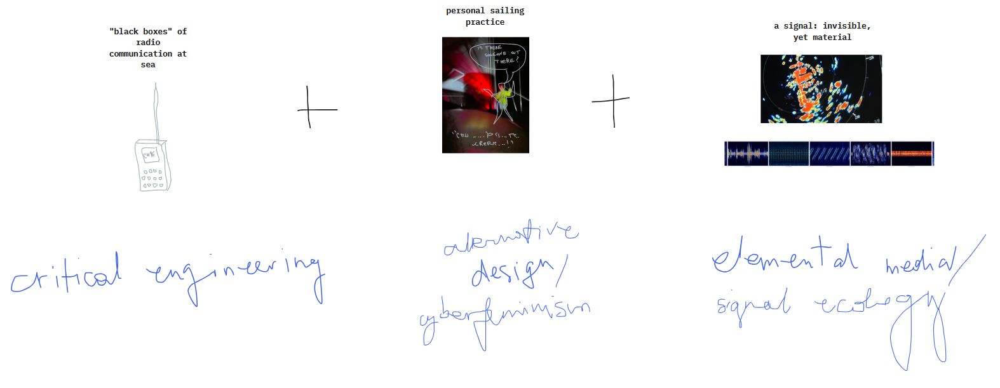

# Master Media Design Thesis
## HEAD, Geneva, 2026/27

This folder leaves a trace of my documentation for my master thesis.

#### Research Questions:

1. How could the critical use of radio devices open up ways to reappropriate the black boxes of communication in the constrained space of a sailing boat?

2. How can the current radio network be challenged by employing a more eco-feminist approach, listening and imagining otherwise, and reconnecting to the radio-oceanic space?

#### [This](https://docs.google.com/document/d/1QyAFCbq82Wv2VnBwuYVfgGu0j2MKPr-Xfmq18WlifTQ/edit?usp=sharing) is the Google doc where I write stuff, mainly comments about the environment and about books that I read
#### [This](https://www.tldraw.com/f/SqBBJcFgW7ncyqGTwlZJ2?d=v-590.1794.1807.930.page) is the board where I dump ideas and images